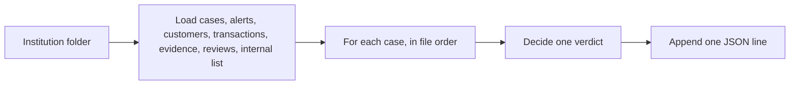
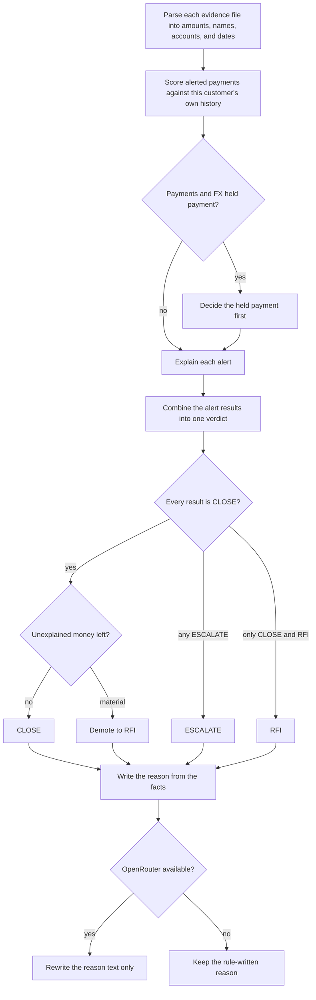
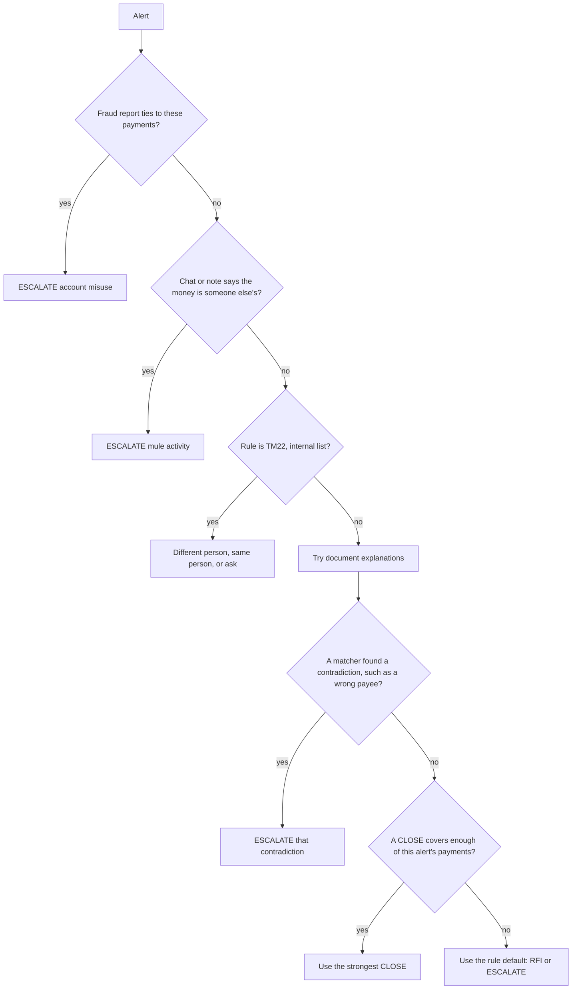
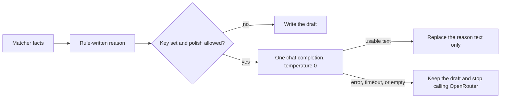

# Alert-closing system

The challenge, the scoring, and what to deliver are in the [top-level README](../README.md).

This folder is a deterministic Python 3 decision engine. It uses only the standard library. Given one institution folder, it reads every case and writes one verdict per case.

A case is one customer over one review window, with every alert that fired in that window. One verdict covers the whole case:

- **CLOSE** when documents on file explain the alerted activity.
- **RFI** when nothing looks criminal yet, and one specific document or answer from the customer would settle it. The reason says what to ask for.
- **ESCALATE** when the money is unexplained or there are signs of crime. Once there is suspicion, the case goes to the MLRO. The system does not ask the customer.

A wrongful close is the expensive mistake, so the engine closes only when a document actually lines up with the payments. Escalating everything is also a bad result, so an explained case is closed and an unclear but unsuspicious case is an RFI.

No case IDs, customer names, amounts, or document IDs from the development set are hardcoded. Thresholds come from each institution's `POLICY.md` via `policy.py`.

## What a run writes

`system/run` writes one JSON object per line, in the same order as `cases.jsonl`:

```json
{"case_id": "BK-CS112964", "alert_ids": ["BK-AL4810357"], "verdict": "CLOSE", "reason_code": "INVOICE_MATCHES", "reason": "Invoice INV-7291 for £4,200.00 matches payment BK-T100 of £4,200.00 to the joiner.", "evidence": ["INV-7291", "BK-T100"]}
```

| Field | Meaning |
|---|---|
| `case_id` | The case, copied from `cases.jsonl` |
| `alert_ids` | Every alert in that case, in the same order |
| `verdict` | `CLOSE`, `RFI`, or `ESCALATE` |
| `reason_code` | The main ground. It always belongs to that verdict |
| `reason` | Two to four sentences naming this case's documents, people, and amounts. An RFI ends with the ask |
| `evidence` | Document, transaction, list, or earlier-review IDs the decision relied on. IDs that are not in the case files are dropped |

## How a run moves



`loader.py` reads the JSONL files once, then builds a bundle for each case: the customer, the alerts, the transactions those alerts cite, the customer's wider transaction history, the Markdown evidence, earlier reviews, the internal list, and any held payment.

The working directory does not matter. `system/run` is called with two full paths:

```bash
system/run institutions/bank output/bank.jsonl
system/run institutions/emoney output/emoney.jsonl
system/run institutions/investment output/investment.jsonl
system/run institutions/payments_fx output/payments_fx.jsonl
```

Browsable HTML of all case verdicts (filters by institution / verdict):

```bash
python3 system/generate_case_verdicts_html.py -o output/case-verdicts.html
```

## Inside one case



Statistics never close a case by themselves. They only change the fallback: a rapid payment to a new counterparty escalates, a recurring payment of the usual size can become an RFI instead, and a document-backed close that still leaves a novel large payment unexplained is demoted to an RFI.

## Reading the evidence

Each evidence row points at a Markdown file. `evidence_parse.py` pulls out:

- labelled lines such as amount, supplier, account holder, and company number
- every pound amount in the text
- account numbers
- a primary amount, preferring the money that actually moved (for a completion statement, the proceeds paid to the client, not the conveyancing fee)

Two names count as the same party after company words such as Ltd and LLP are stripped. They match when the names are equal, one contains the other ("Wenfield Joinery Ltd" matches "Wenfield Joinery"), or both have at least two words and share two of them. A single shared surname does not match two different full names ("Taylor Smith" does not match "Jesse Smith").

An amount matches when it is within £1 or within 1% , whichever test passes. Cash and takings reconciliations use a slightly wider tolerance (£5 on a line, £25 on a total). Invoice and event dates more than 60 days from the payment are ignored.

## One alert

Suspicion is checked before any close. A close that only covers a sliver of the alert is thrown away, and the alert then falls through to the rule default.



The document checks, in order, are invoice or contract, own account, group company, cash or takings records, a one-off event, investment third-party funding, a refund of an earlier payment, a returning customer, within-profile, and (for TM10 only) an early-redemption explanation. If several succeed, an escalation beats a close, and among closes the one with the higher weight wins. Weights prefer a specific document match over a soft profile story.

### What each explanation needs

| Story | What must line up | Reason code |
|---|---|---|
| Invoice, contract, purchase order, payment file, receipt, remittance, credit note | Amount, and the named counterparty appears on the document. A named supplier who is a different party, on a single payment of the same amount, is an invoice mismatch | `INVOICE_MATCHES` or `ESC_INVOICE_MISMATCH` |
| Own account | A statement or register shows the customer holds the other account, and the alerted leg is the customer's own name or that account number. Activity at 5× the declared monthly income, turnover, or payment volume is an RFI for an updated profile, not a close | `OWN_ACCOUNT` or `RFI_UPDATED_PROFILE` |
| Group company | A register, group chart, or factoring agreement names both the customer and the other company. A payment to the customer themselves is not a group payment | `GROUP_COMPANY` |
| Cash collections, ticket reports, takings, reconciliations, management accounts | The recorded lines, or their total, match the alerted cash or deposits. A handful of matching lines does not clear a long list of deposits | `COLLECTION_DOCUMENTED` or `BUSINESS_RECORDS_RECONCILE` |
| Sale, gift, loan, insurance, redundancy, completion, booking, solicitor letter | The document amount matches a payment, the date is close, and the counterparty or the customer is named. A gift letter is a documented third party. A deposit-return or refund letter is a refund | `DOCUMENTED_EVENT`, `THIRD_PARTY_DOCUMENTED`, or `REFUND_OF_EARLIER_PAYMENT` |
| Dormant account | Only TM07, and only with a reverification record whose largest alerted payment is most of the money that moved. An earlier review note is not enough. The policy says an earlier review covers only what it describes | `RETURNING_CUSTOMER` |
| Within profile | A contact note that says the activity fits the profile does not close a TM01 alert. TM01 has already fired because the money is over the limit | not used to close a real TM01 breach |
| Early redemption (investment TM10) | A cancellation confirmation, or a letter of need (redundancy, completion, insurance) together with an own-account payout | `DOCUMENTED_EVENT`, otherwise `ESC_EARLY_REDEMPTION` |
| Internal list (TM22) | Close only when a date of birth, birth year, address, or company record shows a different party. Escalate when the register shows the listed person controls the counterparty. Otherwise ask who the counterparty is | `LIST_MATCH_DIFFERENT_PARTY`, `ESC_LISTED_PARTY`, or `RFI_COUNTERPARTY_DETAILS` |

A close also has to cover the shape of the rule, not just one convenient payment:

| Rule | A close must cover |
|---|---|
| TM01, over the declared profile | Most of the money received, or most of the amount above the declared baseline |
| TM02, rapid in-and-out | Both the money in and the money out, unless the story is own-account, a refund, or an invoice. A car loan may cite the inbound loan and the outbound dealer payment |
| TM03, amounts just under a threshold | At least half of the repeated payments |
| TM04, many counterparties | At least half of the legs, or half of the value. A documented collection can leave ordinary salary payments uncited if most of the inbound collection is covered |
| TM05, large cash | The cash payment itself |
| TM06, higher-risk country | The corridor payment, or a document that explains that payment |
| TM07, dormant account wakes up | About 85% of the money that moved |
| TM08 and TM10 | At least one of the alerted payments |

### If no document explains it

| Rule | Default |
|---|---|
| TM01, over profile | RFI. A business, or a customer who already has takings records, is asked for business records. An individual is asked for source of funds. The ask names a novel payer or a surge against the customer's own history when those are present |
| TM02, rapid movement | Escalate as pass-through. If both sides look like the customer's normal recurring payments and nobody new is involved, ask for purpose documents instead |
| TM03, just under the threshold | Escalate as structuring, unless some records exist but do not reconcile, in which case ask for the breakdown |
| TM04, many counterparties | Escalate as mule activity |
| TM05, large cash | RFI for source of funds. The ask notes when the cash is far above this customer's usual cash |
| TM06, higher-risk country | Escalate. The reason names the undeclared country |
| TM07, dormant account | RFI for what resumed the activity, unless reverification already closed it |
| TM08, third-party name | Escalate as third-party funding |
| TM10, early redemption | Escalate unless a cancellation or a documented need explains it |
| Anything else with no story | Escalate as unexplained funds |

Mule language is a short fixed list of phrases in chats, contact notes, staff notes, and customer emails ("not my money", "pass it on", and similar). A sending-bank fraud report escalates as account misuse when its amount, its named party, or its date (within 14 days) ties to the alert.

## Several alerts, one verdict

Each alert produces one result. The case result is the strictest of those, with one extra check before a close:

1. **Any escalate wins.** The reason code is the most serious of the escalate codes: listed party, mule, account misuse, pass-through, structuring, early redemption, third-party funding, invoice mismatch, higher-risk corridor, then unexplained funds. The evidence list still includes the documents cited by the other alerts.
2. **Every alert closed.** The case is closed only if the leftover money is small. Otherwise it becomes an RFI asking for source of funds for the remainder.
3. **A mix of closes and RFIs.** The case is an RFI. The reason code prefers an updated profile, then counterparty details, purpose documents, business records, then source of funds.
4. **Anything else**, including an alert with no result, escalates as unexplained funds.

When several closes survive, the reason code prefers the most identity-sensitive story first (a cleared list match, then an invoice, own account, group company, collection, business records, event, third party, refund, returning customer, within profile).

### The leftover-money check

This runs only when every alert wanted to close.

- `RETURNING_CUSTOMER` and `WITHIN_PROFILE` do not count as explaining pounds. They confirm identity, not where the money came from.
- A case that is only a cleared list match can close without citing every payment.
- Every other alert must cite at least one of its own transactions.
- A payment the customer's history marks as new and large, and that no document cited, blocks the close.
- Other leftover value can remain when it is at most £500, or at most 10% of the alerted value, or no larger than the declared TM01 baseline (plus £50 for rounding). A recurring payment of the usual size can sit inside that baseline. Anything above that is an RFI, and the reason names an example payment.

## Payments and FX held payments

On `payments_fx`, a case can include a payment that has not been released. That payment is decided before the alerts:

- If it is to the client and a statement proves the account, it is own-account (or an updated-profile RFI at 5×).
- If an invoice or contract matches it, that match stands, including a payee mismatch.
- If it is £10,000 or more to anyone other than the client and nothing matches, the case asks for that invoice before release.

The alerts are still decided afterwards. Soft `ESC_PASS_THROUGH` defaults cannot override a documented held CLOSE when no hard suspicion code is present — remaining unexplained outs become a purpose/invoice RFI (residual coverage still blocks thin CLOSEs). Hard escalate codes (mule, unexplained third-party funding, list, fraud, structuring, and similar) still escalate the case.

## Customer history

`stats.py` looks only at transactions booked before the review window starts. From that history it records:

- the usual size of payments on each channel
- whether a counterparty is paid on a regular gap, at a regular amount
- whether an alerted payment is large and new (seen at most once before, and above both the usual channel size and a floor)
- how this month's inbound total compares with the customer's usual month
- how alerted cash compares with the customer's usual cash

Those flags are used in the rule defaults and in the leftover-money check. They are also allowed to add one sentence to a document-backed close when a cited payment is the customer's usual recurring amount. They are not a reason code.

## The reason, and OpenRouter

`reason.py` turns the matcher facts into two to four sentences. It names document IDs, transaction IDs, amounts, and counterparties from the case. An RFI that does not already ask for something gets one concrete ask, tied to the largest alerted payment where possible.

That text is the default result. It is what the run returns when OpenRouter is not used.

If `OPENROUTER_API_KEY` is set, and `OPENROUTER_POLISH` is not `0`, `llm_reason.py` may rewrite that paragraph through the OpenRouter chat completions API at temperature 0. The default model is `baidu/ernie-5.5-flash-preview:free`. `OPENROUTER_MODEL` overrides it. The call is told the verdict, the reason code, the evidence IDs, and the draft. It is not allowed to change them. A rewrite that drops the word "ask" on an RFI, or runs past 1,200 characters, is discarded.

If the key is missing, the call times out (10 seconds), or OpenRouter returns an HTTP error or an error body, the rule-written reason is kept. OpenRouter is then not called again in that process, so one dead endpoint does not add a timeout to every remaining case.



The verdict, reason code, and evidence IDs are fixed before this step. Five runs with the key unset produce the same output. Five runs with a working model can differ in wording only.

## Where the code lives

| File | Role |
|---|---|
| `run` | Executable entry point. Loads the folder, decides every case, writes the output file |
| `loader.py` | Reads the institution files and assembles one case bundle |
| `policy.py` | The four institutions' rule sets, multiples, cash bands, and the £10,000 payments gate |
| `evidence_parse.py` | Turns Markdown into amounts, names, dates, and accounts |
| `stats.py` | Per-customer history features. Never a close by itself |
| `matchers.py` | One result per alert: fraud, list, documents, or the rule default |
| `coverage.py` | Demotes a close that leaves material money unexplained |
| `decide.py` | Combines alert results into the case verdict and evidence list |
| `reason.py` | Writes the default reason from the facts |
| `llm_reason.py` | Optional rewrite of that reason. Falls back to the draft |

## Model

Default: no language model. Every verdict, reason code, and reason comes from the rules and the templates above.

Optional polish uses OpenRouter only, and only the reason sentence. Set `OPENROUTER_POLISH=0` to force the default reasons even when a key is present.

## Checks

From the repo root:

```bash
python3 tests/run_audit.py
python3 tests/stats_smoke.py
python3 tests/polish_fallback.py
```

`tests/audit/` is a hand-checked set of clear-cut development cases (fraud reports, exact invoices, list outcomes, the £10,000 gate, 5× own-account RFIs, and similar). It checks the verdict, an accepted reason code, and the required evidence IDs. It is a regression suite, not the answer key for the 4,000 development cases.

## OpenRouter smoke (TypeScript)

`system/openrouter` is a separate smoke client. It is not part of `system/run`. It sends one request with `@openrouter/sdk` and prints the text, using the same free model and temperature 0. It exits non-zero if `OPENROUTER_API_KEY` is unset.

```bash
cd system/openrouter
npm install
export OPENROUTER_API_KEY=sk-or-...
npm run smoke
```

## Runtime and cost

On the development set (1,000 cases per institution), a run with no API key takes a few seconds per institution and costs nothing. The same is true after OpenRouter fails once and the run falls back to the rule-written reasons. A 200-case run stays under the 30-minute and about $4 limits. Optional polish, when the endpoint is healthy, uses the free model above unless `OPENROUTER_MODEL` is set.
